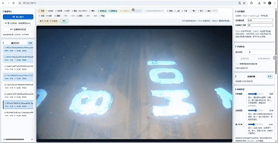
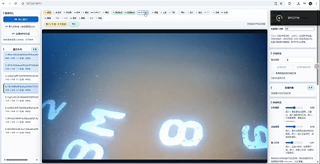

# Water Gauge Auto-Annotation Studio (水尺辅助标注工具)

这是一个基于 **YOLO11 目标检测** 与 **SAM2.1 提示分割** 的水尺自动标注网页工具。

## 💡 项目背景与方案优势
水尺图像标注需要极高的像素级精度，传统人工绘制耗时费力。本项目采用**“高效检测 + 大模型分割”**的两阶段策略，在约 3000 张规模的数据集上实现了极高的标注效率：

1. **高效目标检测 (YOLO11)**：选用 YOLO11 模型进行训练。在 3000 张数据规模下，它收敛快且不易过拟合，能够精准且快速地定位水尺目标的位置与类别，为后续分割提供高质量的提示框（Bounding Box）。
2. **大模型精细分割 (SAM2.1)**：利用 YOLO11 的检测框或人工点击点作为 Prompt（提示），让 SAM2.1 自动生成高精度的像素级多边形（Polygon），彻底免去手动逐点勾画边界的痛苦。
3. **工程化标注闭环**：前端提供交互式控制点修改、批量改名，导出的 LabelMe JSON 可直接用于下一轮模型训练。通过“自动预标注 -> 人工微调 -> 数据回流”，大幅降低标注成本。

### 为什么选择检测+SAM，而不是直接训练分割？
采用“YOLO11 检测 + SAM2.1 分割”的两阶段方案，在 3000 张数据规模下具有显著优势：

| 维度 | 纯检测 | 纯实例分割 | **检测 + SAM（本项目）** |
| :--- | :--- | :--- | :--- |
| **标注成本** | 低 | 高，需要像素掩码 | **低到中，框+人工轻量修正** |
| **3000张数据** | 较友好 | 掩码标注不足时极难收敛 | **较友好（检测单独训练）** |
| **类别识别** | 好 | 好 | **YOLO 负责** |
| **边界精度** | 粗 | 细 | **极细（由 SAM2.1 负责）** |
| **训练难度** | 较低 | 较高 | **较低（解耦，易替换）** |
| **失败兜底** | 无 | 无 | **可通过点击 SAM 重新分割** |

## ✨ 核心功能
- **批量自动标注**：导入文件夹，一键调用 YOLO11 + SAM2.1 生成全图预标注。
- **点击自动识别**：点击图片目标位置，SAM 生成区域，YOLO11 识别类别。
- **灵活的人工编辑**：支持拖拽控制点、线框吸附、撤销/重做、删除、复制粘贴。
- **自动保存**：直接读写本地文件夹，实时将结果保存为 LabelMe 格式的 JSON，无需手动导出。

## 🛠️ 技术栈
- **前端**：原生 JavaScript、Canvas、CSS3
- **后端**：Python、FastAPI
- **模型**：Ultralytics YOLO11 (检测)、SAM2.1 (分割)
- **数据格式**：LabelMe JSON

## 🚀 如何运行
1. 环境准备
请准备好 Python 环境（推荐 3.9 及以上版本），在项目根目录下安装所需的依赖库：

bash
pip install ultralytics fastapi uvicorn opencv-python numpy python-multipart pillow

2. 权重与模型准备
YOLO11 检测权重：将本项目提供的 yolo11n_water_gauge.pt 放入后端指定目录（例如 backend/weights/）。

SAM2.1 分割模型：请自行下载 SAM2.1 权重（如 sam2.1_hiera_tiny.pt），并按照后端代码的配置路径放置。

3. 启动 Web 标注工具
本工具通过 YOLO 进行目标框选，结合 SAM2.1 进行边缘精细化分割。

第一步：启动后端服务

在项目根目录下，打开终端执行以下命令（服务默认运行在 8010 端口）：

bash
uvicorn backend.main:app --host 127.0.0.1 --port 8010 --reload
第二步：启动前端

后端启动成功后，直接双击打开项目中的前端文件 index.html，即可在浏览器中开始高效标注。

## 📦 模型权重下载
请前往 [(https://github.com/Kan9C00L/water-gauge-annotator/releases/download/v1.0.0/yolo11_water_gauge.pt)] 页面下载 `yolo11_water_gauge.pt` 模型权重，并将其放置在项目根目录下。
## 模型说明 / Model Details

### 基础架构
- **Model**: YOLO11n (Ultralytics)
- **Task**: Object Detection
- **Input Size**: 768×768
- **Classes**: 11

### 训练配置
- **Pretrained Weights**: yolo11m.pt (fine-tuned to n-scale)
- **Optimizer**: AdamW (lr0≈0.00182, lr_f≈0.00182, weight_decay≈0.00053)
- **Epochs**: 500 (patience=35)
- **Batch Size**: 16
- **Device**: GPU
- **Framework**: Ultralytics 8.4.90

sam2.1分割模型可自行下载

## 📄 声明
本项目仅供学习与研究使用。使用的 YOLO11 模型遵循 AGPL-3.0 协议，SAM2.1 遵循 Apache 2.0 协议。
